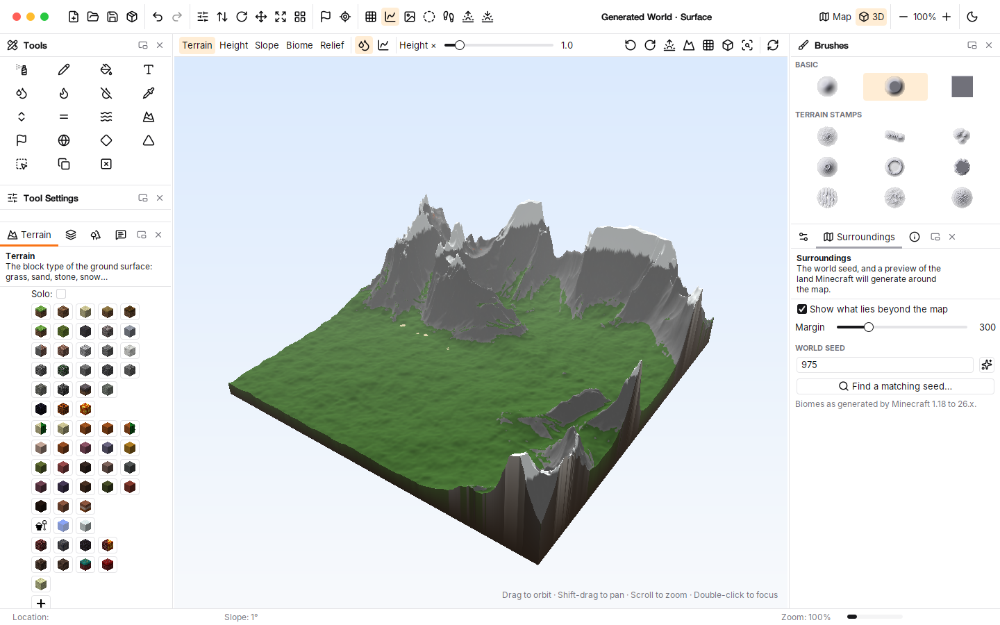
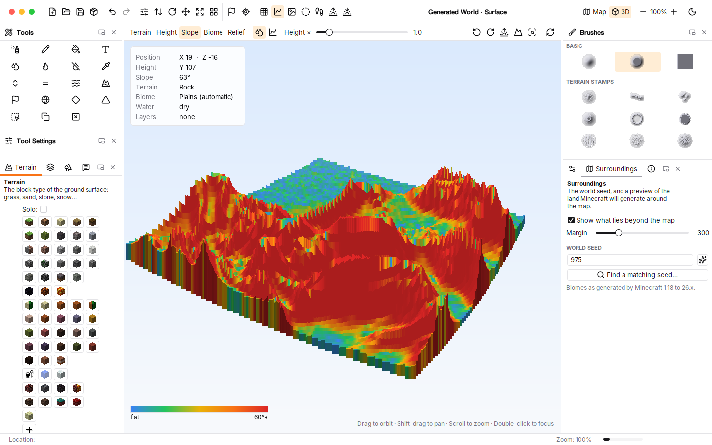
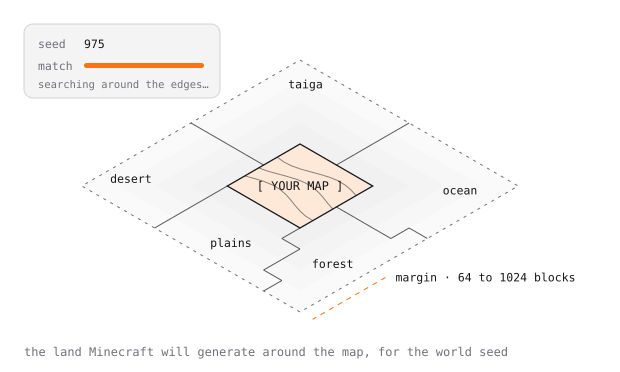
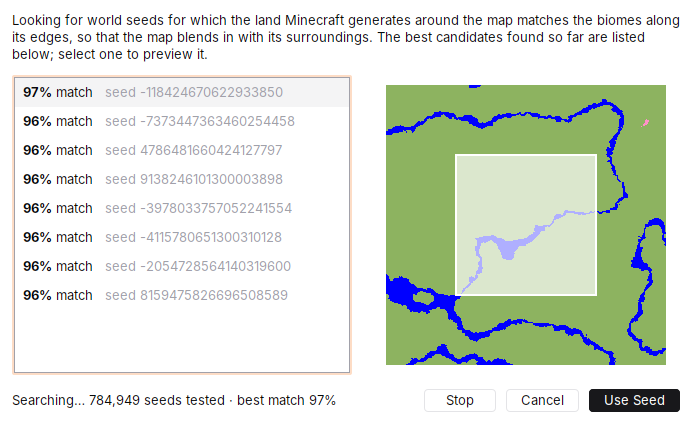

<picture>
  <source media="(prefers-color-scheme: dark)" srcset="docs/assets/hero-dark.svg">
  
</picture>

<p align="center">
  <b>Peindre des mondes Minecraft complets, plus vite.</b><br>
  Vue 3D intégrée, aperçu du monde autour de la carte, recherche de seed, bords de carte adoucis et interface claire et sombre, en application native sur macOS, Windows et Linux.
</p>

<p align="center">
  <a href="https://github.com/M-U-C-K-A/WorldPainter/actions/workflows/build.yml"></a>
  
  
  
  <a href="LICENSE"></a>
</p>

<p align="center">
  <b><a href="https://m-u-c-k-a.github.io/WorldPainter/">Documentation</a></b> ·
  <a href="https://m-u-c-k-a.github.io/WorldPainter/tutorial-first-archipelago.html">Premier tutoriel</a> ·
  <a href="#aperçu">Aperçu</a> ·
  <a href="#vue-3d-intégrée">Vue 3D</a> ·
  <a href="#autour-de-la-carte">Autour de la carte</a> ·
  <a href="#seeds">Seeds</a> ·
  <a href="#interface">Interface</a> ·
  <a href="#pinceaux-et-tampons-de-relief">Pinceaux</a> ·
  <a href="#fondu-des-bords">Bords</a> ·
  <a href="#génération-procédurale">Procédural</a> ·
  <a href="#installer">Installer</a>
</p>

<picture>
  <source media="(prefers-color-scheme: dark)" srcset="docs/assets/divider-dark.svg">
  
</picture>

## Aperçu

> La documentation complète (fonctionnalités, nœuds, tutoriels pas à pas, feuille de route) est sur **[m-u-c-k-a.github.io/WorldPainter](https://m-u-c-k-a.github.io/WorldPainter/)** ; ses sources sont dans [`site/`](site/).

<picture>
  <source media="(prefers-color-scheme: dark)" srcset="docs/images/screenshot-dark.png">
  
</picture>

WorldPainter permet de « peindre » des paysages Minecraft avec des outils proches de ceux d'un logiciel de dessin : sculpter le relief, peindre les matériaux, les arbres, la neige, les biomes… puis exporter une carte jouable. Ce fork part de la dernière version du projet d'origine, [Captain-Chaos/WorldPainter](https://github.com/Captain-Chaos/WorldPainter) 2.27, compatible de **Minecraft 1.20.5 à 26.x**. Il le rend plus simple à prendre en main et ajoute ce qui manquait pour créer vite une carte complète : voir le résultat en 3D, savoir ce qu'il y aura autour, et choisir la bonne seed.

<picture>
  <source media="(prefers-color-scheme: dark)" srcset="docs/assets/divider-dark.svg">
  
</picture>

## Vue 3D intégrée

<picture>
  <source media="(prefers-color-scheme: dark)" srcset="docs/assets/view3d-dark.svg">
  
</picture>

Les boutons **Map / 3D** en haut à droite basculent l'espace de travail entre la carte et une vue 3D de la dimension, dans la même fenêtre.

- **Fiche du bloc survolé** : position X / Z, hauteur Y, pente, terrain, biome (peint ou automatique), profondeur d'eau et calques présents.
- **5 modes d'affichage** : *Terrain* (couleurs des blocs), *Height* (dégradé d'altitude), *Slope* (du bleu pour le plat au rouge pour les pentes de 60° et plus), *Biome* et *Relief* (ombrage et courbes de niveau), avec leur légende.
- **Eau** et **courbes de niveau** activables, **exagération du relief** réglable.
- Vraie **perspective** ou projection **orthographique** (sans déformation, les distances restent comparables), vue rasante, plongeante ou **vue de dessus** orientée au nord.
- Navigation : glisser pour tourner, <kbd>⇧</kbd> + glisser pour se déplacer, molette pour zoomer, double-clic pour centrer sur un point ; boutons de rotation et de recadrage.
- La carte est affichée comme une maquette posée sur un socle, rendue en maillage 3D sur tous les cœurs (environ 10 ms par image) ; les très grandes cartes sont simplifiées pour rester fluides.

<picture>
  <source media="(prefers-color-scheme: dark)" srcset="docs/images/view3d-dark.png">
  
</picture>



<picture>
  <source media="(prefers-color-scheme: dark)" srcset="docs/assets/divider-dark.svg">
  
</picture>

## Autour de la carte

<picture>
  <source media="(prefers-color-scheme: dark)" srcset="docs/assets/surroundings-dark.svg">
  
</picture>

Panneau **Surroundings**, case **Show what lies beyond the map**. Autour de la carte s'affichent, en transparence, les biomes que Minecraft générera pour la seed du monde : un désert à gauche, une plaine en haut, un océan à droite… On sait à l'avance sur quoi vont donner les bords de la carte.

- **Marge** réglable de 64 à 1024 blocs autour de la carte (300 par défaut : une carte de 200 × 200 est montrée jusqu'à 800 × 800).
- Les frontières entre biomes sont tracées, et la barre d'état indique le biome sous le curseur (« Minecraft will generate: River »).
- Les biomes sont calculés par un portage Java de la génération de [Cubiomes](https://github.com/Cubitect/cubiomes), vérifié à l'identique sur des milliers de points. Disponible pour la surface des cartes Minecraft 1.18 et plus, en type de monde *Default* ou *Large Biomes*.

<picture>
  <source media="(prefers-color-scheme: dark)" srcset="docs/assets/divider-dark.svg">
  
</picture>

## Seeds

La seed du monde se modifie directement dans le panneau **Surroundings** (un nombre, ou n'importe quel texte comme dans Minecraft), avec deux boutons :

- **Seed aléatoire** : tire une nouvelle seed ; l'aperçu autour de la carte se met à jour aussitôt.
- **Find a matching seed…** : cherche une seed pour laquelle le terrain généré autour de la carte correspond à ce qui est peint le long de ses bords. Une forêt d'épicéas en bas à gauche et de l'eau à droite ? La recherche vise une taïga en bas à gauche et un océan à droite. Jusqu'à un million de seeds sont testées en parallèle ; les 8 meilleures s'affichent avec leur pourcentage de correspondance et un aperçu, et s'il n'existe pas de correspondance parfaite, on choisit simplement la plus proche.



<picture>
  <source media="(prefers-color-scheme: dark)" srcset="docs/assets/divider-dark.svg">
  
</picture>

## Interface

<picture>
  <source media="(prefers-color-scheme: dark)" srcset="docs/assets/interface-dark.svg">
  
</picture>

- **Panneaux expliqués** : *Terrain* (le type de bloc du sol), *Layers* (ce qui se pose par-dessus : arbres, neige, minerais, cavernes…), *Biomes* et *Annotations* (repères de couleur pour planifier la carte, non exportés sauf si on l'active à l'export) ont chacun un en-tête qui dit à quoi ils servent.
- **Thèmes clair et sombre** inspirés de shadcn/ui (palette zinc, accent orange, coins arrondis, séparateurs fins), police **Inter**, et un mode **automatique qui suit le système**. Bascule à chaud avec le bouton soleil/lune de la barre d'outils.
- **Icônes [Lucide](https://lucide.dev)** pour la barre d'outils, les outils, les calques et les panneaux, et une nouvelle icône d'application.
- **Infobulles explicatives** au survol de chaque outil (nom, raccourci, explication) à la place des anciennes bulles jaunes.
- **Canevas à grille de points** autour de la carte.
- **Panneaux ancrables** redimensionnables dans les deux sens, regroupés en onglets compacts, détachables dans une fenêtre et ré-affichables via **View › Panels**.
- Sur macOS, la barre d'outils fait office de **barre de titre unifiée**.

<picture>
  <source media="(prefers-color-scheme: dark)" srcset="docs/assets/divider-dark.svg">
  
</picture>

## Pinceaux et tampons de relief

Un seul panneau **Brushes**, sans menu caché :

- **3 formes de base** : rond doux, rond plateau et carré.
- **9 tampons de relief** générés procéduralement, pour sculpter en un geste avec les outils de hauteur : pic, chaîne de montagnes, massif, volcan, rebord de cratère, mesa, dunes, collines, dôme érodé.
- Les pinceaux personnalisés (dossier `brushes` de la configuration) restent pris en charge.

### Éditeur de nœuds

**Generate › Node graph terrain…** (<kbd>⇧</kbd> <kbd>⌘</kbd> <kbd>N</kbd>), dans l'esprit de Gaia ou World Machine : on relie des nœuds sur un canevas et on obtient une carte complète, relief, terrains, biomes et végétation compris.

- **Générateurs** : bruit de Perlin, bruit à crêtes, bruit « billow », dunes, cellules (Voronoï), dégradé (radial, carré ou linéaire, ajusté à la carte), constante, image en niveaux de gris importée et **carte actuelle** (pour retravailler un relief peint à la main).
- **Combinaisons** : ajouter, soustraire, multiplier, maximum, minimum, mélange avec masque. **Filtres** : courbe éditable, terrasses, bornage, flou, érosion (ravines ramifiées qui descendent les pentes) et érosion thermique.
- **Eau** : **rivières** sinueuses (largeur constante, lit creusé, berges en pente, eau au niveau du fond de vallée, biome rivière ou rivière gelée, elles s'effacent au-dessus d'une altitude choisie) et **lacs** aux rives irrégulières, remplis juste sous le point le plus bas de leur pourtour. Le fond (gravier, sable…) est peint automatiquement.
- **Masques** : plage d'altitude, plage de pente et sélection. Sans branchement, les masques lisent le terrain final.
- **Surface** : peindre un terrain (roche, sable, neige, terre cuite…), un **biome** Minecraft (43 biomes) ou de la **flore** (forêts de feuillus, de pins, jungle, marais, neige, herbes et fleurs, fougères, plantes du désert, champignons). Le masque le plus fort l'emporte, avec des bordures mouchetées naturelles.
- Chaque nœud affiche une **vignette** ; aperçu **relief**, **surface**, **biomes** ou du nœud sélectionné.
- Édition confortable : **annuler / rétablir**, **sélection multiple** (<kbd>⇧</kbd> clic, <kbd>⇧</kbd> glisser, <kbd>⌘</kbd> <kbd>A</kbd>), copier-coller et dupliquer, **ouverture et enregistrement de graphes** (`.wpgraph`) pour les réutiliser d'un monde à l'autre.
- Application à toute la carte ou à la **sélection avec bords adoucis**, annulable ; le graphe est **enregistré avec le monde**.
- **9 exemples** de cartes complètes : collines, montagnes érodées, archipel tropical, canyons de mesa, dunes du désert, île volcanique, lacs et forêts, vallées et rivières, et « éroder la carte actuelle ». Évaluation par tuiles en parallèle, identique au bit près à un calcul d'un seul tenant : aucune couture.

<picture>
  <source media="(prefers-color-scheme: dark)" srcset="docs/assets/divider-dark.svg">
  
</picture>

## Fondu des bords

<picture>
  <source media="(prefers-color-scheme: dark)" srcset="docs/assets/edges-dark.svg">
  
</picture>

**Generate › Blend map edges…**. Une carte de 200 × 200 ne se termine plus par une falaise brute : son relief rejoint progressivement le terrain qui l'entoure.

- **Zone de transition** de 16 à 4096 blocs, à l'extérieur de la carte (qui est alors agrandie), à l'intérieur (le bord est adouci) ou à cheval sur le bord.
- **Cible** : un terrain procédural (par défaut *Minecraft-like*, proche de ce que Minecraft génère au-delà de la carte) ou un niveau plat.
- Forme de la courbe et **irrégularité** réglables ; Minecraft raccorde ensuite les derniers blocs lui-même grâce à son *chunk blending*.


<picture>
  <source media="(prefers-color-scheme: dark)" srcset="docs/assets/divider-dark.svg">
  
</picture>

## Génération procédurale

<picture>
  <source media="(prefers-color-scheme: dark)" srcset="docs/assets/procedural-dark.svg">
  
</picture>

**Generate › Procedural terrain…** (<kbd>⇧</kbd> <kbd>⌘</kbd> <kbd>G</kbd>) pour poser une base de relief avant de peindre :

- une pile de couches de bruit à combiner (relief doux, crêtes, collines, cellules, dunes), avec terrasses, niveau de la mer et règles de surface (neige en altitude, roche sur les pentes, plages) ;
- 8 préréglages, un aperçu en temps réel, et l'application à toute la carte ou à la sélection avec des bords adoucis ;
- un calcul en parallèle sur tous les cœurs, sans couture entre les tuiles, adapté aux très grandes cartes.

<picture>
  <source media="(prefers-color-scheme: dark)" srcset="docs/assets/divider-dark.svg">
  
</picture>

## Installer

Les applications natives (Java intégré, rien d'autre à installer) sont produites par l'intégration continue : ouvrir le dernier build réussi dans l'onglet [Actions](https://github.com/M-U-C-K-A/WorldPainter/actions/workflows/build.yml) et télécharger l'artefact de sa plateforme (macOS Apple Silicon ou Intel, Windows, Linux).

L'application n'est pas signée : sur macOS, l'ouvrir la première fois avec clic droit › Ouvrir.

L'application peut utiliser **jusqu'à 75 % de la mémoire** de la machine (contre 25 % par défaut pour Java), ce qui permet de travailler sur des cartes environ trois fois plus grandes.

## Compiler

Il suffit d'un **JDK 21** et de **Maven** ; toutes les dépendances se téléchargent automatiquement. Détails dans [BUILDING.md](BUILDING.md).

```bash
cd WorldPainter
mvn -DskipTests install       # compiler
mvn -pl WPGUI exec:exec       # lancer
```

Créer l'application native pour la plateforme courante (dans `dist/`) :

```bash
packaging/package.sh          # macOS : dist/WorldPainter.app
packaging/package.sh dmg      # image disque à distribuer
```

Les illustrations de ce README sont générées par [`docs/assets/make_svgs.py`](docs/assets/make_svgs.py).

## Licence et crédits

WorldPainter est un logiciel libre sous **licence GPL version 3**. Si vous le distribuez, tel quel ou modifié, vous devez aussi distribuer le code source (avec vos modifications) sous GPL version 3 ou ultérieure. Voir [LICENSE](LICENSE).

- WorldPainter a été créé par [Pepijn Schmitz (Captain-Chaos)](https://github.com/Captain-Chaos) et ses contributeurs.
- Génération des biomes Minecraft portée de [Cubiomes](https://github.com/Cubitect/cubiomes) (licence MIT).
- Icônes [Lucide](https://lucide.dev) (licence ISC), thèmes [FlatLaf](https://www.formdev.com/flatlaf/) (Apache 2.0), police [Inter](https://rsms.me/inter/) (SIL OFL).

[](https://github.com/Captain-Chaos/WorldPainter/graphs/contributors)
