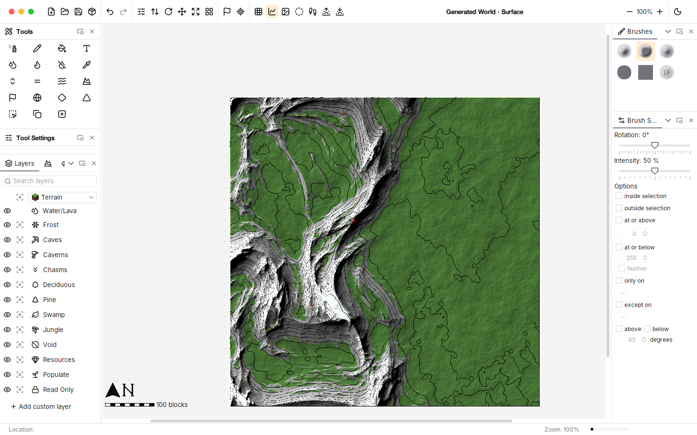
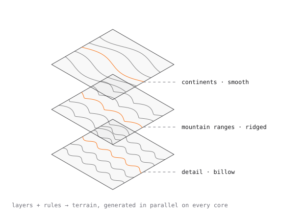
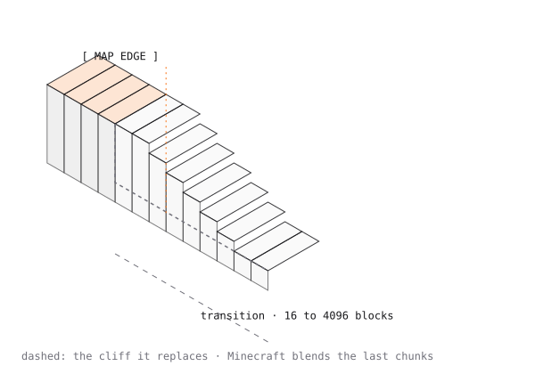
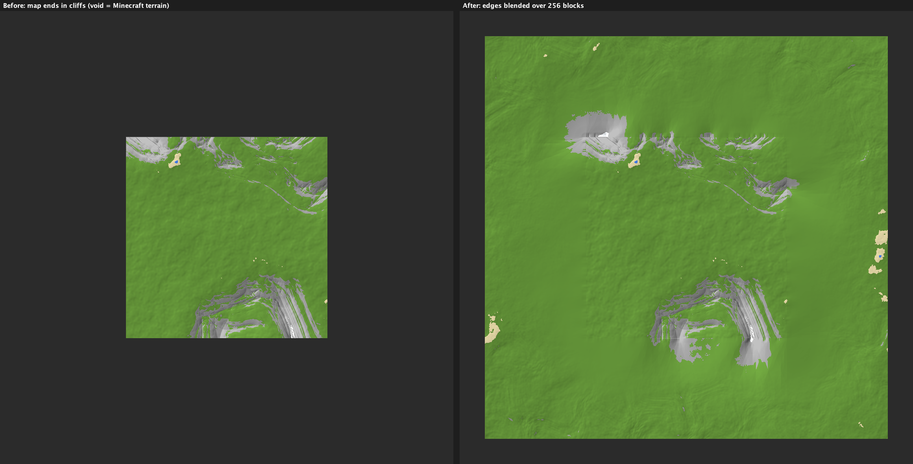

<picture>
  <source media="(prefers-color-scheme: dark)" srcset="docs/assets/hero-dark.svg">
  
</picture>

<p align="center">
  <b>L'éditeur de cartes Minecraft où l'on peint des mondes, modernisé.</b><br>
  Génération procédurale, bords de carte qui se fondent dans le paysage, interface claire et sombre, application native sur macOS, Windows et Linux.
</p>

<p align="center">
  <a href="https://github.com/M-U-C-K-A/WorldPainter/actions/workflows/build.yml"></a>
  
  
  
  <a href="LICENSE"></a>
</p>

<p align="center">
  <a href="#aperçu">Aperçu</a> ·
  <a href="#génération-procédurale">Procédural</a> ·
  <a href="#fondu-des-bords">Fondu des bords</a> ·
  <a href="#interface">Interface</a> ·
  <a href="#pinceaux-et-tampons-de-relief">Pinceaux</a> ·
  <a href="#installer">Installer</a> ·
  <a href="#compiler">Compiler</a>
</p>

<picture>
  <source media="(prefers-color-scheme: dark)" srcset="docs/assets/divider-dark.svg">
  
</picture>

## Aperçu

<picture>
  <source media="(prefers-color-scheme: dark)" srcset="docs/images/screenshot-dark.png">
  
</picture>

WorldPainter permet de « peindre » des paysages Minecraft avec des outils proches de ceux d'un logiciel de dessin : sculpter le relief, peindre les matériaux, les arbres, la neige, les biomes… puis exporter une carte jouable. Ce fork part de la dernière version du projet d'origine, [Captain-Chaos/WorldPainter](https://github.com/Captain-Chaos/WorldPainter) 2.27, compatible de **Minecraft 1.20.5 à 26.x**, et le modernise.

<picture>
  <source media="(prefers-color-scheme: dark)" srcset="docs/assets/divider-dark.svg">
  
</picture>

## Génération procédurale

<picture>
  <source media="(prefers-color-scheme: dark)" srcset="docs/assets/procedural-dark.svg">
  
</picture>

**Generate › Procedural terrain…** (<kbd>⇧</kbd> <kbd>⌘</kbd> <kbd>G</kbd>)

- Une **pile de couches de bruit** à combiner (ajouter, soustraire, maximum, minimum, multiplier) : relief doux, crêtes montagneuses, collines arrondies, cellules (volcans, cratères), dunes.
- Pour chaque couche : taille des reliefs, hauteur, détail, rugosité, netteté des sommets, déformation, **couverture** (pour des chaînes ou des îles séparées) et direction.
- Terrasses, niveau de la mer et **règles de surface** : neige en altitude, roche sur les pentes raides, plages au bord de l'eau…
- **8 préréglages** : Minecraft-like, plaines, collines, montagnes alpines, archipel, canyons de mesa, dunes, îles volcaniques.
- **Aperçu en relief en temps réel**, application à toute la carte ou à la **sélection avec bords adoucis**.
- Calcul en parallèle sur tous les cœurs, sans couture entre les tuiles : adapté aux très grandes cartes.

<picture>
  <source media="(prefers-color-scheme: dark)" srcset="docs/assets/divider-dark.svg">
  
</picture>

## Fondu des bords

<picture>
  <source media="(prefers-color-scheme: dark)" srcset="docs/assets/edges-dark.svg">
  
</picture>

**Generate › Blend map edges…**. Une carte de 200 × 200 ne se termine plus par une falaise brute : son relief rejoint progressivement le terrain qui l'entoure.

- **Zone de transition** de 16 à 4096 blocs, à l'extérieur de la carte (qui est alors agrandie), à l'intérieur (le bord est adouci) ou à cheval sur le bord.
- **Cible** : un terrain procédural (par défaut *Minecraft-like*, proche de ce que Minecraft génère au-delà de la carte) ou un niveau plat.
- Forme de la courbe et **irrégularité** réglables ; le relief du bord est flouté progressivement avec la distance, sans stries ni cassures aux coins.
- Minecraft raccorde ensuite les derniers blocs lui-même grâce à son *chunk blending*.



<picture>
  <source media="(prefers-color-scheme: dark)" srcset="docs/assets/divider-dark.svg">
  
</picture>

## Interface

<picture>
  <source media="(prefers-color-scheme: dark)" srcset="docs/assets/interface-dark.svg">
  
</picture>

- **Thèmes clair et sombre** inspirés de shadcn/ui (palette zinc, accent orange, coins arrondis, séparateurs fins), police **Inter**, et un mode **automatique qui suit le système**. Bascule à chaud avec le bouton soleil/lune de la barre d'outils.
- **Icônes [Lucide](https://lucide.dev)** pour la barre d'outils, les outils, les calques et les panneaux.
- **Panneau de calques** façon logiciel de design : recherche, icônes de visibilité et de solo, lignes en pleine largeur.
- **Infobulles explicatives** au survol de chaque outil (nom, raccourci, explication) à la place des anciennes bulles jaunes.
- **Canevas à grille de points** autour de la carte.
- **Panneaux ancrables** redimensionnables, regroupés en onglets compacts, détachables dans une fenêtre et ré-affichables via **View › Panels**.
- Sur macOS, la barre d'outils fait office de **barre de titre unifiée**.

<picture>
  <source media="(prefers-color-scheme: dark)" srcset="docs/assets/divider-dark.svg">
  
</picture>

## Pinceaux et tampons de relief

- Un **jeu réduit de 6 pinceaux** polyvalents (doux, plateau, linéaire, disque, carré, bruit), affichés en relief ombré.
- Une palette **Terrain Stamps** de 9 tampons générés procéduralement pour sculpter un relief reconnaissable en un geste avec les outils de hauteur : pic, chaîne de montagnes, massif, volcan, rebord de cratère, mesa, dunes, collines, dôme érodé.
- Les pinceaux personnalisés (dossier `brushes` de la configuration) restent pris en charge.

<picture>
  <source media="(prefers-color-scheme: dark)" srcset="docs/assets/divider-dark.svg">
  
</picture>

## Installer

Les applications natives (Java intégré, rien d'autre à installer) sont produites par l'intégration continue : ouvrir le dernier build réussi dans l'onglet [Actions](https://github.com/M-U-C-K-A/WorldPainter/actions/workflows/build.yml) et télécharger l'artefact de sa plateforme (macOS Apple Silicon ou Intel, Windows, Linux).

L'application n'est pas signée : sur macOS, l'ouvrir la première fois avec clic droit › Ouvrir.

L'application peut utiliser **jusqu'à 75 % de la mémoire** de la machine (contre 25 % par défaut pour Java), ce qui permet de travailler sur des cartes environ trois fois plus grandes.

## Compiler

Il suffit d'un **JDK 21** et de **Maven** ; toutes les dépendances se téléchargent automatiquement. Détails dans [BUILDING.md](BUILDING.md).

```bash
cd WorldPainter
mvn -DskipTests install       # compiler
mvn -pl WPGUI exec:exec       # lancer
```

Créer l'application native pour la plateforme courante (dans `dist/`) :

```bash
packaging/package.sh          # macOS : dist/WorldPainter.app
packaging/package.sh dmg      # image disque à distribuer
```

Les illustrations de ce README sont générées par [`docs/assets/make_svgs.py`](docs/assets/make_svgs.py).

## Licence et crédits

WorldPainter est un logiciel libre sous **licence GPL version 3**. Si vous le distribuez, tel quel ou modifié, vous devez aussi distribuer le code source (avec vos modifications) sous GPL version 3 ou ultérieure. Voir [LICENSE](LICENSE).

- WorldPainter a été créé par [Pepijn Schmitz (Captain-Chaos)](https://github.com/Captain-Chaos) et ses contributeurs.
- Icônes [Lucide](https://lucide.dev) (licence ISC), thèmes [FlatLaf](https://www.formdev.com/flatlaf/) (Apache 2.0), police [Inter](https://rsms.me/inter/) (SIL OFL).

[](https://github.com/Captain-Chaos/WorldPainter/graphs/contributors)
