<picture>
  <source media="(prefers-color-scheme: dark)" srcset="docs/assets/hero-dark.svg">
  
</picture>

<p align="center">
  <b>Paint complete Minecraft worlds, faster.</b><br>
  An integrated 3D view, a preview of the land around the map, seed search, soft map edges and a light and dark interface, as a native application for macOS, Windows and Linux.
</p>

<p align="center">
  <a href="https://github.com/M-U-C-K-A/WorldPainter/actions/workflows/build.yml"></a>
  
  
  
  <a href="LICENSE"></a>
</p>

<p align="center">
  <b><a href="https://m-u-c-k-a.github.io/WorldPainter/">Documentation</a></b> ·
  <a href="https://m-u-c-k-a.github.io/WorldPainter/tutorial-first-archipelago.html">First tutorial</a> ·
  <a href="#overview">Overview</a> ·
  <a href="#integrated-3d-view">3D view</a> ·
  <a href="#around-the-map">Around the map</a> ·
  <a href="#seeds">Seeds</a> ·
  <a href="#interface">Interface</a> ·
  <a href="#brushes-and-terrain-stamps">Brushes</a> ·
  <a href="#edge-blending">Edges</a> ·
  <a href="#node-graph">Node graph</a> ·
  <a href="#install">Install</a>
</p>

<picture>
  <source media="(prefers-color-scheme: dark)" srcset="docs/assets/divider-dark.svg">
  
</picture>

## Overview

> The full documentation (features, nodes, step by step tutorials, roadmap) is at **[m-u-c-k-a.github.io/WorldPainter](https://m-u-c-k-a.github.io/WorldPainter/)**; its sources are in [`site/`](site/).

<picture>
  <source media="(prefers-color-scheme: dark)" srcset="docs/images/screenshot-dark.png">
  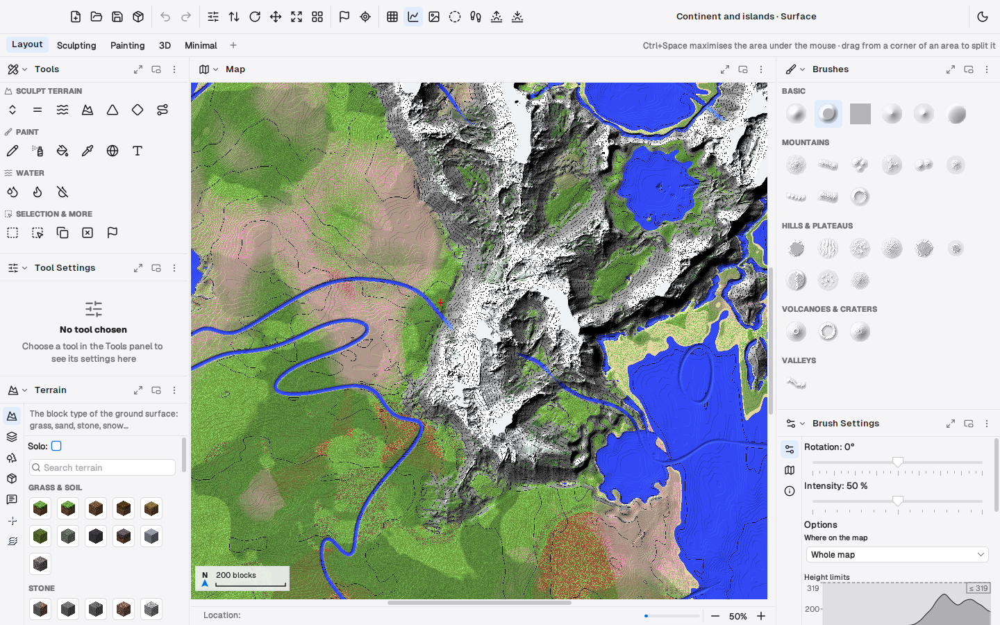
</picture>

WorldPainter lets you "paint" Minecraft landscapes with tools much like those of a drawing program: sculpt the relief, paint the materials, the trees, the snow, the biomes… then export a playable map. This fork starts from the latest version of the original project, [Captain-Chaos/WorldPainter](https://github.com/Captain-Chaos/WorldPainter) 2.27, compatible with **Minecraft 1.20.5 to 26.x**. It makes it easier to pick up and adds what was missing to create a complete map quickly: seeing the result in 3D, knowing what will lie around it, and choosing the right seed.

This is an unofficial fork, not affiliated with or supported by the original project: please report problems [here](https://github.com/M-U-C-K-A/WorldPainter/issues).

<picture>
  <source media="(prefers-color-scheme: dark)" srcset="docs/assets/divider-dark.svg">
  
</picture>

## Integrated 3D view

<picture>
  <source media="(prefers-color-scheme: dark)" srcset="docs/assets/view3d-dark.svg">
  
</picture>

The **3D** workspace shows a 3D view of the dimension next to the map, in the same window, and any area can show it.

- **Details of the block under the cursor**: X / Z position, Y height, slope, terrain, biome (painted or automatic), water depth and the layers present.
- **5 display modes**: *Terrain* (block colours), *Height* (altitude gradient), *Slope* (from blue for flat ground to red for slopes of 60° and more), *Biome* and *Relief* (shading and contour lines), each with its legend.
- **Water**, **trees** (the forest layers and the tree pack, as simple shapes with their density) and **contour lines** can be switched on, and the **relief exaggeration** adjusted.
- True **perspective** or **orthographic** projection (no distortion, so distances stay comparable), low, high or **top down** view facing north.
- Navigation: drag to rotate, <kbd>⇧</kbd> + drag to pan, scroll to zoom, double-click to centre on a point; buttons to rotate and to fit the view.
- The map is shown as a model on a base, rendered as a 3D mesh on all cores (about 10 ms per frame); very large maps are simplified to stay smooth.

<picture>
  <source media="(prefers-color-scheme: dark)" srcset="docs/images/view3d-dark.png">
  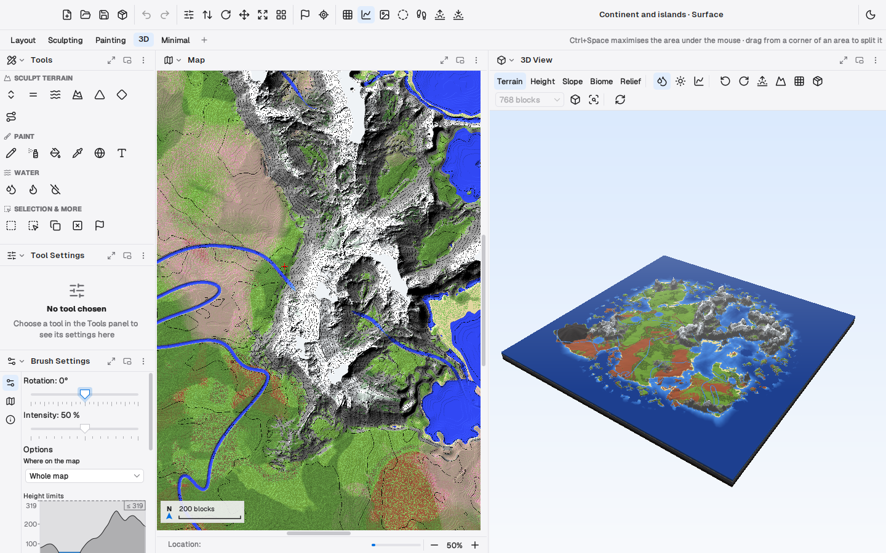
</picture>

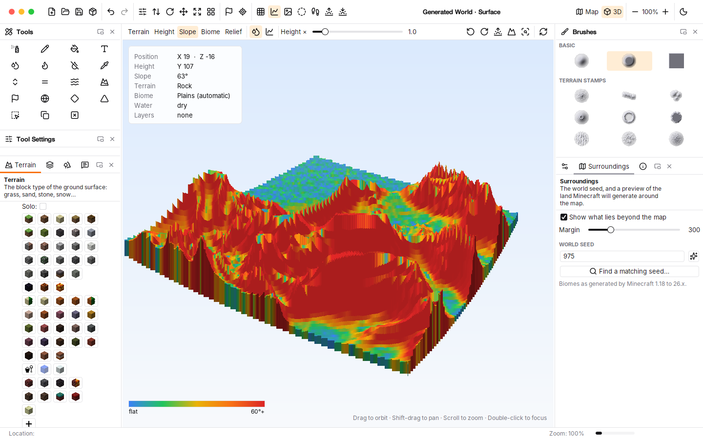

<picture>
  <source media="(prefers-color-scheme: dark)" srcset="docs/assets/divider-dark.svg">
  
</picture>

## Around the map

<picture>
  <source media="(prefers-color-scheme: dark)" srcset="docs/assets/surroundings-dark.svg">
  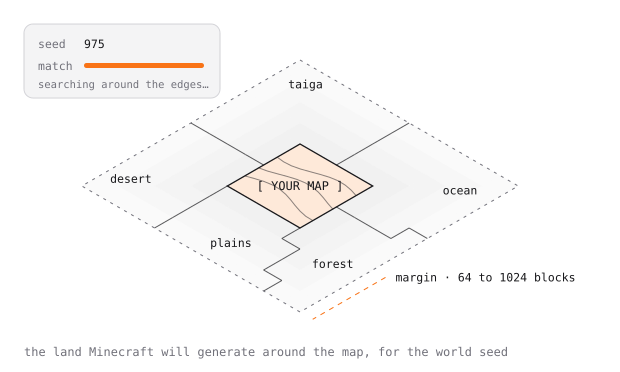
</picture>

**Surroundings** panel, **Show what lies beyond the map** checkbox. Around the map, the biomes Minecraft will generate for the world seed are shown in transparency: a desert on the left, plains at the top, an ocean on the right… You know in advance what the edges of the map will run into.

- Adjustable **margin** of 64 to 1024 blocks around the map (300 by default: a 200 × 200 map is shown up to 800 × 800).
- The borders between biomes are drawn, and the status bar shows the biome under the cursor ("Minecraft will generate: River").
- The biomes are computed by a Java port of the generation of [Cubiomes](https://github.com/Cubitect/cubiomes), checked to be identical on thousands of points. Available for the surface of Minecraft 1.18 and later maps, with the *Default* or *Large Biomes* world type.

<picture>
  <source media="(prefers-color-scheme: dark)" srcset="docs/assets/divider-dark.svg">
  
</picture>

## Seeds

The world seed can be changed directly in the **Surroundings** panel (a number, or any text as in Minecraft), with two buttons:

- **Random seed**: picks a new seed; the preview around the map updates straight away.
- **Find a matching seed…**: looks for a seed for which the land generated around the map matches what is painted along its edges. A spruce forest at the bottom left and water on the right? The search aims for a taiga at the bottom left and an ocean on the right. Up to a million seeds are tested in parallel; the best 8 are shown with their match percentage and a preview, and if there is no perfect match you simply pick the closest.

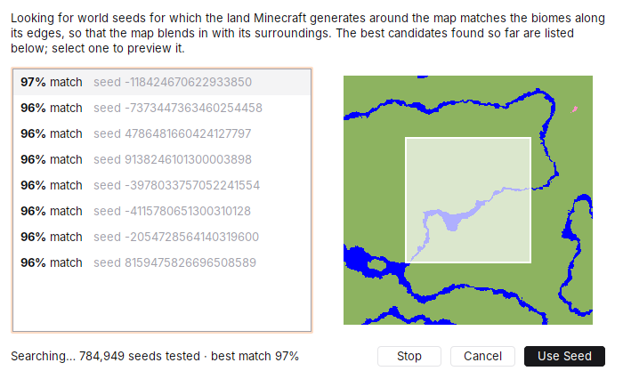

<picture>
  <source media="(prefers-color-scheme: dark)" srcset="docs/assets/divider-dark.svg">
  
</picture>

## Interface

<picture>
  <source media="(prefers-color-scheme: dark)" srcset="docs/assets/interface-dark.svg">
  
</picture>

- **Self-explaining panels**: *Terrain* (the block type of the ground), *Layers* (what goes on top: trees, snow, ores, caves…), *Biomes* and *Annotations* (coloured markings to plan the map, not exported unless enabled on export) each have a header saying what they are for.
- **Four designs, Modern, Classic, Glass and Tactile**, each light, dark or **following the system**: Modern has layered grey surfaces, a blue accent and grouped settings in the style of macOS, with the **Geist** font; Classic looks like a classic desktop application, as WorldPainter used to: a grey window (charcoal in the dark), square controls with clear borders, buttons with a slight gradient, title bars on the areas, scroll bars with arrows, the font of the system and the original icons of WorldPainter; Glass has frosted panels on a soft gradient, translucent cards and black pill buttons; Tactile has controls you feel you could touch: buttons standing half out of the window, the default one in orange, sliders sunk into grooves with their ticks inside, selected tools standing out as tiles, and the map on a grid. They change at once in the preferences, without restarting; the sun/moon button in the toolbar switches between light and dark.
- **[Lucide](https://lucide.dev) icons** for the toolbar, the tools, the layers and the panels, and a new application icon.
- **Explanatory cards** when hovering over each tool (name, shortcut, explanation) instead of the old yellow tooltips.
- A **dotted grid canvas** around the map.
- **What the map shows**: the bar at the top of the map shows the land as painted, or its **height** (with contour lines), **slope**, **biome** or **relief** on its own, as the 3D view does, while the tools paint as usual.
- **Areas as in Blender**: the window is divided into areas, which are resized by dragging the gaps between them, split and joined from their corners, moved and swapped by dragging their header, maximised with <kbd>Ctrl</kbd>+<kbd>Space</kbd> and detached into a window which floats over the main one. The button at the top left of each area chooses what it shows (the map and the 3D view can be shown in several areas, each with its own view), and **workspace tabs** keep several arrangements (Layout, Sculpting, Painting, 3D, Minimal, and your own). Hold <kbd>Shift</kbd> to close areas with one click; hover over a choice of the editor type menu for a card with a picture of the page.
- On macOS, the toolbar doubles as a **unified title bar**, and the Finder shows the **map of a world as the icon of its `.world` file**.
- A **faster export**: *Export FAST*, next to the classic *Export*, is about a third faster on large maps, with exactly the same blocks and light.
- **Half blocks**: the **Half Blocks** tool, next to Smooth, smooths the land like Smooth and builds it in half blocks in Minecraft where you drag it: slabs on stone, cobblestone, sandstone and the like (waterlogged under water), snow layers on snow blocks, so that gentle slopes go up by half a block instead of a whole block every other column. Right-drag goes back to whole blocks; the map shows where it applies with amber stripes. Grass, dirt and sand have no slab and stay whole. To smooth the whole map at once, use **Global operations › smooth the terrain** with **in half blocks** ticked; its filters (selection, heights, terrain, slope) limit where it applies.

<picture>
  <source media="(prefers-color-scheme: dark)" srcset="docs/assets/divider-dark.svg">
  
</picture>

## Brushes and terrain stamps

A single **Brushes** panel, with no hidden menu:

- **3 basic shapes**: soft round, flat round and square.
- **Procedurally generated terrain stamps**, to sculpt in one stroke with the height tools: peak, mountain range, massif, volcano, crater rim, mesa, dunes, hills, eroded dome…
- **Your own brushes**, managed in the app: add them from images, make, rename and delete groups, and drag a brush onto another group to move it, without restarting. The custom brushes of the original WorldPainter are copied the first time. Any area can **show all the pages of its kind at once** (all your brush groups, all your layer palettes) instead of tabs.
- **Curvature** in the brush settings: limit a brush to hollows (valleys, dips) or to bumps (ridges, peaks), from 0.1 block deep and over a reach you choose, as well as by height, terrain, layers and slope.
- **Selection**: drag a rectangle or an ellipse, or paint it with the brush as in the original WorldPainter; **Copy Selection** can turn the copy a quarter turn at a time and mirror it.
- **Rivers** with the Path tool: dug along a line, flowing downhill, with a bed of sand and gravel, the river biome and sloping banks.

### Node editor

**Generate › Node graph terrain…** (<kbd>⇧</kbd> <kbd>⌘</kbd> <kbd>N</kbd>), in the spirit of Gaia or World Machine: connect nodes on a canvas and get a complete map, relief, terrain, biomes and vegetation included.

- **Generators**: Perlin noise, ridged noise, billow noise, dunes, cells (Voronoi), gradient (radial, square or linear, fitted to the map), constant, imported greyscale image and **current map** (to rework a hand-painted relief).
- **Combinations**: add, subtract, multiply, maximum, minimum, blend with a mask. **Filters**: editable curve, terraces, clamp, blur, erosion (branching gullies running down the slopes) and thermal erosion.
- **Water**: winding **rivers** (constant width, carved bed, sloping banks, water at the level of the valley floor, river or frozen river biome, fading out above a chosen altitude) and **lakes** with irregular shores, filled to just below the lowest point of their rim. The bottom (gravel, sand…) is painted automatically.
- **Masks**: height range, slope range and selection. When not connected, masks read the final terrain.
- **Surface**: paint a terrain (rock, sand, snow, terracotta…), a Minecraft **biome** (43 biomes) or **vegetation** (deciduous, pine and jungle forests, swamp, snow, grass and flowers, ferns, desert plants, mushrooms). The strongest mask wins, with natural speckled borders.
- Each node shows a **thumbnail**; preview the **relief**, the **surface**, the **biomes** or the selected node.
- Comfortable editing: **undo / redo**, **multiple selection** (<kbd>⇧</kbd> click, <kbd>⇧</kbd> drag, <kbd>⌘</kbd> <kbd>A</kbd>), copy, paste and duplicate, **opening and saving graphs** (`.wpgraph`) to reuse them from one world to the next.
- Apply to the whole map or to the **selection with soft edges**, with undo; the graph is **saved with the world**.
- **Examples** of complete maps: hills, eroded mountains, tropical archipelago, mesa canyons, desert dunes, volcanic island, lakes and forests, valleys and rivers, and "erode the current map". Evaluated in parallel tiles, identical to the bit to a computation in one piece: no seams.

<picture>
  <source media="(prefers-color-scheme: dark)" srcset="docs/assets/divider-dark.svg">
  
</picture>

## Edge blending

<picture>
  <source media="(prefers-color-scheme: dark)" srcset="docs/assets/edges-dark.svg">
  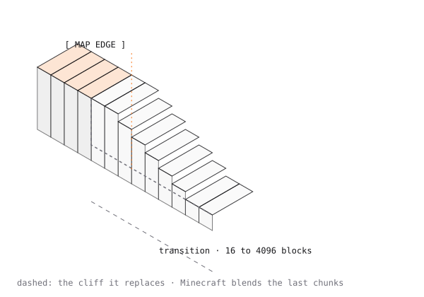
</picture>

**Generate › Blend map edges…**. A 200 × 200 map no longer ends in a sheer cliff: its relief goes over gradually into the land around it.

- **Transition zone** of 16 to 4096 blocks, outside the map (which is then enlarged), inside it (the edge is softened) or across the edge. Round maps are blended too.
- **Target**: generated terrain from a preset (*Minecraft-like* by default, close to what Minecraft generates beyond the map) or a flat level.
- Adjustable curve shape and **irregularity**; WorldPainter marks the chunks of the map so that Minecraft (1.19 and later) joins up the last blocks itself with its *chunk blending*, as it does for worlds made before 1.18.

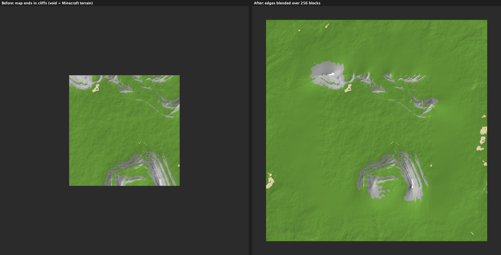

<picture>
  <source media="(prefers-color-scheme: dark)" srcset="docs/assets/divider-dark.svg">
  
</picture>

## Node graph

<picture>
  <source media="(prefers-color-scheme: dark)" srcset="docs/assets/procedural-dark.svg">
  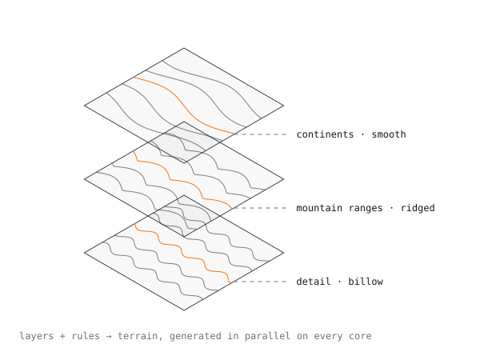
</picture>

**Generate › Node graph terrain…** (<kbd>⇧</kbd> <kbd>⌘</kbd> <kbd>N</kbd>) to generate a complete world before painting it by hand:

- noise, landforms (mountains, rolling hills, an island) in one node, erosion, rivers, lakes, masks, and painters for the terrain, the biomes and the vegetation, wired together with a live preview;
- examples to start from, from a Minecraft-like world or plains to an archipelago, mesa canyons or floating islands;
- applied to the whole map or to the selection with soft edges, computed in parallel on all cores with no seams between tiles, suited to very large maps.

<picture>
  <source media="(prefers-color-scheme: dark)" srcset="docs/assets/divider-dark.svg">
  
</picture>

## Install

Download the latest version from the [Releases](https://github.com/M-U-C-K-A/WorldPainter/releases) page: a native application per platform (macOS Apple Silicon or Intel, Windows, Linux), with Java included and nothing else to install. The untested build of each change is also available in the [Actions](https://github.com/M-U-C-K-A/WorldPainter/actions/workflows/build.yml) tab.

The application is not signed: on macOS, open it the first time with right-click › Open. It keeps its settings apart from those of the original WorldPainter, so both can be installed side by side.

The application can use **up to 75% of the memory** of the machine (instead of Java's default of 25%), which allows working on maps about three times larger.

## Build

All you need is **JDK 21** and **Maven**; all dependencies are downloaded automatically. Details in [BUILDING.md](BUILDING.md).

```bash
cd WorldPainter
mvn -DskipTests install       # build
mvn -pl WPGUI exec:exec       # run
```

Create the native application for the current platform (in `dist/`):

```bash
packaging/package.sh          # macOS: dist/WorldPainter.app
packaging/package.sh dmg      # disk image to distribute
```

The illustrations in this README are generated by [`docs/assets/make_svgs.py`](docs/assets/make_svgs.py).

## Licence and credits

WorldPainter is free software under the **GNU General Public License version 3**. If you distribute it, as is or modified, you must also distribute the source code (with your changes) under the GPL version 3 or later. See [LICENSE](LICENSE).

- WorldPainter was created by [Pepijn Schmitz (Captain-Chaos)](https://github.com/Captain-Chaos) and its contributors.
- Minecraft biome generation ported from [Cubiomes](https://github.com/Cubitect/cubiomes) (MIT licence).
- [Lucide](https://lucide.dev) icons (ISC licence), [FlatLaf](https://www.formdev.com/flatlaf/) themes (Apache 2.0), [Geist](https://vercel.com/font) font by Vercel (SIL OFL 1.1).

[](https://github.com/Captain-Chaos/WorldPainter/graphs/contributors)
